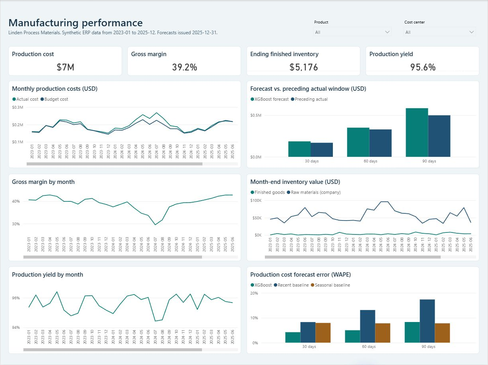
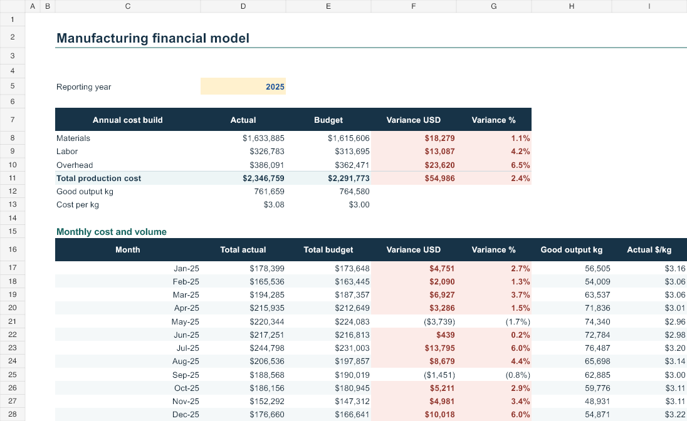
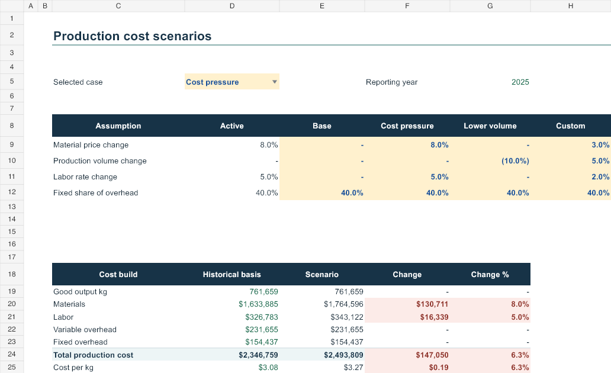
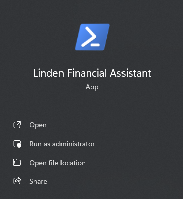
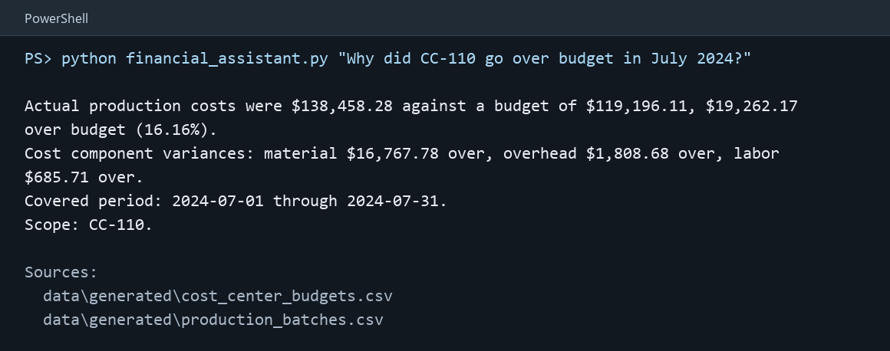

# Chemical Manufacturing ERP Financial Forecasting & AI Analytics

Created by **Robert Bishop**, Accountancy & Finance · **Riley Murray**, Mathematics & Economics at ETSU

We built a financial forecasting and reporting project for a fictional chemical manufacturer, using three years of synthetic SAP S/4HANA-style data.

The project tracks production costs, reconciles inventory and ledger balances, and forecasts costs and gross profit over 30, 60, and 90 days. We built an Excel financial model, a Power BI dashboard, and a local financial assistant to review the results.

In the 2025 simulation, production costs totaled **$2,346,759.25**, or **$3.08 per kg** of finished output. Actual costs were **$54,986.01 over budget**.

## Machine learning

### XGBoost forecasts

We started with a simple estimate based on what happened over the preceding 30, 60, or 90 days. [XGBoost](forecast_erp.py), a model that combines decision trees, learned how much to adjust that estimate using recent trends, the time of year, and the number of weekdays ahead. It produced 30 forecasts covering raw-material price per kg, material purchase spend, production cost, and product gross profit.

### Forecast testing

We retrained the models at historical month-ends using only data available at each date. We compared the 30-, 60-, and 90-day forecasts with the actual results for those periods. Across 690 historical predictions, we also compared XGBoost with estimates based on the immediately preceding period and the matching period 52 weeks earlier.

The percentages below show **weighted absolute percentage error (WAPE)**, which compares the total size of the forecast errors with the total size of the actual values. Lower is better.

| XGBoost target            | 30 days | 60 days | 90 days |
| ------------------------- | ------: | ------: | ------: |
| Material purchase spend   |  11.32% |   9.86% |   9.87% |
| Raw-material price per kg |   4.72% |   6.12% |   8.47% |
| Production cost           |   4.22% |   5.00% |   8.32% |
| Product gross profit      |   7.06% |   5.83% |   8.00% |

XGBoost was more accurate than both alternatives at all three horizons for purchase spend and gross profit. The recent-history estimate did better for raw-material prices. For 90-day production costs, the prior-year estimate had a small edge at **7.79% WAPE**.

### Isolation Forest batch screening

We trained an [Isolation Forest](detect_erp_risks.py) on earlier batches for the same product and cost center. Its decision trees identify batches that are easy to separate from the rest based on scrap rate, labor cost, and overhead cost. Both costs are measured per kilogram of input so batches of different sizes can be compared. A batch was flagged when its overall score was unusual and at least one of those measures was high. **82 of 1,566 batches** were flagged for review.

### Rule-based risk checks

| Check                    | How it works                                                                                                                                                                    |
| ------------------------ | ------------------------------------------------------------------------------------------------------------------------------------------------------------------------------- |
| Purchase price           | Compare the order price per kg with recent orders for the same material. The simulation flagged 17 orders with unusually high prices.                                           |
| Production cost variance | Scale budgeted costs to the batch's actual good output, then compare with actual material, labor, and overhead costs. The simulation flagged 250 unfavorable variances.         |
| Budget overrun           | Use month-to-date cost per business day to estimate month-end spending and compare it with the cost center's budget. We checked these estimates against actual month-end costs. |

## Power BI executive dashboard



The dashboard breaks down production costs, gross margin, finished-goods inventory, yield, and forecasts by product and cost center. The forecast chart shows the previous 30, 60, or 90 days of actual costs alongside each forecast. Raw-material inventory is tracked company-wide.

## Excel financial model



The workbook shows actual material, labor, and overhead costs alongside the budget, plus the cost per kg. The scenario tab recalculates total cost and cost per kg when you change material prices, production volume, or labor rates. Fixed overhead stays the same when volume changes.



## Linden Financial Assistant

The [Linden Financial Assistant](financial_assistant.py) is a command-line tool for asking about costs, budgets, forecasts, and risk flags. It runs **Qwen2.5-3B-Instruct** locally through llama.cpp using the **Q4_K_M GGUF** model file. No API key is required. [Qwen model card](https://huggingface.co/Qwen/Qwen2.5-3B-Instruct-GGUF)

Qwen interprets the question. Python calculates the answer from the data and model outputs and then also cites the source files. In one test, the assistant reported a **$19,262.17** July 2024 budget overrun for cost center CC-110 and broke it down into material, labor, and overhead variances. Pretty cool stuff



The Windows shortcut shown here opens the assistant in a terminal.



Output

## Data and tools

- The [Python ERP generator](generate_erp.py) and [reconciliation checks](validate_erp.py) connect 16 source tables from 2023 through 2025. We verified 6,029 balanced journal documents and 180 month-end inventory balances. Inventory uses moving-average costing.
- The forecasting and risk scripts use pandas, NumPy, XGBoost, and scikit-learn. [Excel](build_financial_workbook.py) imports the forecasts, and [Power BI](build_power_bi.py) uses DAX to calculate the dashboard measures.
- The [PostgreSQL loader](load_erp_database.py) brought in 53,453 rows across 25 tables and passed 23 reconciliation checks. Its [SQL views](erp_schema.sql) provide monthly costs and product margins for reporting.

## Reproduce locally

From the project folder, install the Python dependencies and generate the ERP and analytics exports.

```powershell
python -m pip install -r requirements.txt
python generate_erp.py
python validate_erp.py data/generated
python forecast_erp.py
python detect_erp_risks.py
```

Create the reporting deliverables and load the database.

```powershell
python build_financial_workbook.py
python build_power_bi.py
python load_erp_database.py --start-db
```

- **Excel** uses the bundled Node workbook runtime. Run the builder with `--help` to supply its executable and package paths.
- **Power BI** opens the generated `.pbip` in Power BI Desktop. Make sure to refresh when on a newly built project.
- **PostgreSQL** uses a local PostgreSQL 17 installation. Supply `--pg-bin` if its binaries are outside the default location. Add `--rebuild-analytics` to regenerate the forecast and risk exports before loading.
- **Financial assistant** starts with `python financial_assistant.py` once llama.cpp and the Qwen model file are available. Run `python financial_assistant.py --help`
